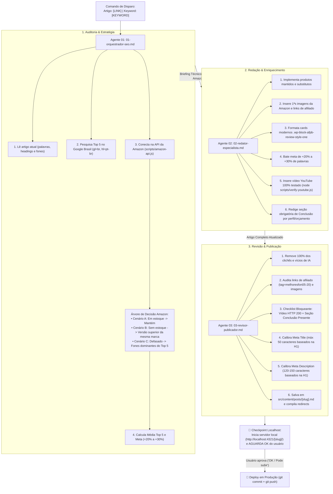

# 🚀 Guia Operacional: Esteira de Atualização SEO & Automação Amazon (`agents-atualizacoes`)

Esta pasta (`agents-atualizacoes/`) contém uma esteira dedicada e autônoma de **Auditoria de SERP, Atualização de Conteúdo SEO e Automação de Produtos Amazon**, operando em paralelo com a esteira original de criação de novos posts (localizada na pasta `agents-novos-artigos/`).

---

## ⚡ Como Disparar a Esteira com 1 Único Comando

Basta enviar no chat o comando no formato abaixo:

```text
Artigo: [LINK/CAMINHO] | Keyword: [PALAVRA-CHAVE]
```

### Exemplos Práticos:
* **Exemplo 1 (Artigo Comercial com Fones):**
  ```text
  Artigo: /fone-qcy-e-bom/ | Keyword: fone qcy e bom
  ```
* **Exemplo 2 (Guia Comparativo de Melhores Fones):**
  ```text
  Artigo: /melhores-fones-bluetooth/ | Keyword: melhores fones bluetooth 2026
  ```
* **Exemplo 3 (Caminho de Arquivo Local):**
  ```text
  Artigo: src/content/posts/melhores-fones-para-corrida.md | Keyword: fone para corrida
  ```

---

## 🔄 Fluxo Sequencial dos 3 Agentes



> 🛑 **REGRA BLOQUEANTE DE PREVIEW LOCAL:** Nunca faça `git commit`, `git push` ou deploy para produção antes de entregar o link do `localhost` (`npm run dev -- --host --port 4321`) e receber o **"OK"** explícito do usuário!

---

## 🛠️ Ferramentas Oficiais da Esteira

### 1. Integração com a API da Amazon (`scripts/amazon-api.js`)
* **Checagem de Estoque e Dados:**
  ```bash
  node scripts/amazon-api.js check <ASIN_OU_URL>
  ```
* **Busca de Modelos Superiores / Concorrentes:**
  ```bash
  node scripts/amazon-api.js search "<TERMO>"
  ```
  *Gera links comissionados com `tag=melhoresfon05-20` e 1ªs imagens oficiais.*

### 2. Validador de Vídeos do YouTube (`scripts/verify-youtube.js`)
* **Checagem Prévia Obrigatória:**
  ```bash
  node scripts/verify-youtube.js <VIDEO_ID_OU_URL>
  ```
  *Retorna status HTTP 200, título e confirmação de autorização de incorporação antes do vídeo entrar no post.*

---

## 📂 Arquivos Desta Pasta (`agents-atualizacoes/`):
1. `00-fluxo-disparo.md` — Guia operacional e comando único de disparo.
2. `01-orquestrador-seo.md` — Analista de SERP, estrategista, auditor da Amazon e validador de vídeo/conclusão.
3. `02-redator-especialista.md` — Redator técnico, aplicador de cards modernos, vídeo validado e seção de conclusão.
4. `03-revisor-publicador.md` — Humanizador anti-IA, checagem bloqueante (vídeo ativo + conclusão), calibrador de meta tags e publicador.

---

## 🚨 Regra Bloqueante: Pesquisa SEMPRE no Google Brasil
- O Top 5 é levantado **somente no Google Brasil** (`google.com.br`, `gl=br&hl=pt-BR`), em navegador real (Chrome; no Windows, `chrome.exe --headless=new --dump-dom` se não houver ferramenta de navegador).
- **JAMAIS** usar DuckDuckGo, Bing, `search_web` ou outro buscador. Se o Google pedir captcha ou bloquear, **pare e avise o usuário**.

---

## 🚨 Regra Bloqueante: Disponibilidade Real e Estoque na Amazon Brasil
- É responsabilidade primária do **Orquestrador** auditar e garantir que **100% dos produtos recomendados** em artigos comerciais possuam **estoque ativo e disponível para compra na Amazon Brasil** (`amazon.com.br`).
- Modelos "Não disponível no momento", "Em falta", fora de linha ou com páginas 404 são **expressamente proibidos**. Havendo indisponibilidade, o Orquestrador deve substituí-los imediatamente por modelos em estoque.

---

## 🚨 Regra Bloqueante: Pretty Links Obrigatórios e Redirect para a Amazon
- Todos os links de botões de compra e conversão `.afpb__btn` devem ser Pretty Links limpos no formato `/[slug-do-produto]/` (ex: `/sony-wh-1000xm4/`, `/shokz-openrun-pro-2/`).
- 🚫 **PROIBIDO** colocar links diretos da Amazon ou links encurtados externos no corpo do texto.
- O Orquestrador deve cadastrar os Pretty Links no `src/data/pretty-links.csv` apontando para a Amazon com `tag=melhoresfon05-20` e compilar via `node scripts/generate-redirects.js` para atualizar o `public/_redirects`.
