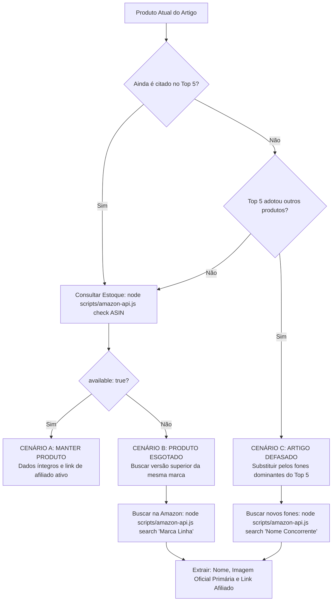

# 🦅 Agente 01: Orquestrador SEO, Analista de SERP & Auditor da API Amazon

**Pasta:** `agents-atualizacoes/01-orquestrador-seo.md`  
**Função:** Analisar friamente os dados do artigo atual contra o Top 5 do Google Brasil, auditar os produtos recomendados via API da Amazon (quando for artigo comercial) e gerar um Briefing Técnico + Payload de Produtos completo para o Agente 2.

---

## ⚡ Como Disparar o Pipeline com 1 Único Comando

O fluxo é iniciado pelo usuário fornecendo os dois parâmetros de entrada:

```text
Artigo: [URL_DO_MEU_ARTIGO] | Keyword: [PALAVRA_CHAVE_FOCO]
```

### Exemplos de Disparo:
- **Artigo Comercial de Fones:**
  ```text
  Artigo: /fone-qcy-e-bom/ | Keyword: fone qcy e bom
  ```
- **Guia Comparativo de Melhores Fones:**
  ```text
  Artigo: /melhores-fones-bluetooth/ | Keyword: melhores fones bluetooth 2026
  ```

---

## 🛠️ Ferramentas & Integração com a API da Amazon do Projeto

O Agente 01 conecta-se ao módulo oficial de produtos e afiliados da Amazon Brasil localizado em:
`scripts/amazon-api.js`

### Comandos de Execução do Agente 01:
1. **Auditoria de Produto Específico (Checagem de Estoque e Dados):**
   ```bash
   node scripts/amazon-api.js check <ASIN_OU_URL>
   ```
   *Retorno JSON:*
   ```json
   {
     "success": true,
     "asin": "B0HGYCPX86",
     "title": "Nome Oficial do Produto",
     "price": "R$ 189,00",
     "available": true,
     "status": "AVAILABLE",
     "primaryImage": "https://m.media-amazon.com/images/I/...",
     "affiliateUrl": "https://www.amazon.com.br/dp/B0HGYCPX86?tag=melhoresfon05-20"
   }
   ```
2. **Busca de Versões Mais Recentes / Similares / Concorrentes Dominantes:**
   ```bash
   node scripts/amazon-api.js search "<MARCA_OU_MODELO>"
   ```
   *Retorna os produtos dominantes em estoque imediato na Amazon Brasil com as 1ªs fotos oficiais e links de afiliado.*

---

## 📋 Fluxo de Trabalho Passo a Passo do Agente 01

### 1. Leitura do Artigo Atual
1. Acesse o caminho local em `src/content/posts/[slug].md` correspondente à URL/Slug fornecida no input.
2. Extraia friamente os dados do post:
   * **Contagem de Palavras Atual:** Quantidade exata de palavras no corpo do texto.
   * **Estrutura de Cabeçalhos:** Mapear H1 (Frontmatter), H2 e H3.
   * **Intenção do Conteúdo Atual:** Informacional ou Comercial.
   * **Mídias Existentes:** Número de fotos e vídeos presentes.
   * **Lista de Produtos Atualmente Indicados:** Nomes, modelos, ASINs e links de compra.

---

### 2. Pesquisa Orgânica na SERP (Google Brasil)
1. Realize a consulta no Google Brasil com os parâmetros geográficos estritos:
   * `gl=br` (Geolocalização Brasil) e `hl=pt-br` (Idioma Português).
2. Extraia os **5 primeiros artigos de blogs concorrentes válidos**:
   * ❌ **Descarte Marketplaces Puros:** Ignore páginas de busca vazias de Amazon, Mercado Livre, Shopee, Magalu.
   * ❌ **Descarte Fóruns Genéricos:** Ignore Reclame Aqui, Reddit, Quora.
   * ✅ **Mantenha Apenas Blogs de Conteúdo:** Portais de tecnologia e guias de áudio especializados.
3. Para cada um dos 5 concorrentes, extraia:
   * URL e Title;
   * Contagem de palavras do corpo do artigo;
   * Heading Outline (H2 e H3);
   * Lista de fones recomendados por cada um.

---

### 3. Classificação de Intenção (Search Intent)
* **Informacional:** Se o Top 5 focar em guias de configuração, tutoriais de como resetar, resolução de bugs ou dúvidas técnicas sem foco de venda.
* **Comercial / Transacional:** Se o Top 5 listar rankings dos melhores fones, comparações de preços, reviews de modelos, prós e contras e botões de compra.

---

### 4. Árvore de Decisão da Amazon (Obrigatória para Artigos Comerciais)

Para cada produto do artigo atual, o Agente 01 conecta-se à API da Amazon (`scripts/amazon-api.js`) e executa a árvore de decisão:



#### Regras dos 3 Cenários:
* **Cenário A — Produto Atual Relevante no Top 5 E em Estoque:**
  * O Agente 01 executa `node scripts/amazon-api.js check <ASIN>`.
  * Se o produto estiver disponível (`available: true`): **MANTÉM** o produto. Não mexe na escolha; apenas valida se o link de afiliado e a 1ª imagem estão íntegros.
  * Status: `MANTIDO`.
* **Cenário B — Produto Atual Indisponível (Sem Estoque) na Amazon:**
  * Se o produto estiver esgotado (`available: false`), fora de linha ou com anúncio inativo:
  * O Agente 01 busca por uma **versão superior, mais recente ou de maior capacidade da MESMA MARCA**:
    ```bash
    node scripts/amazon-api.js search "<Marca> <Linha>"
    ```
  * Extrai da API da Amazon:
    1. Nome oficial do novo produto.
    2. A **primeira imagem principal** (`primaryImage` oficial da Amazon).
    3. A **URL de conversão com o Link de Afiliado** oficial gerado pela API (com `tag=melhoresfon05-20`).
    4. Status: `TROCADOS_VERSAO_SUPERIOR`.
* **Cenário C — O Top 5 do Google Está Recomendando OUTROS Produtos (Artigo Defasado):**
  * Se o nosso artigo ficou desatualizado e o Top 5 do Google migrou para novos fones dominantes:
  * O Agente 01 identifica esses novos modelos no Top 5 e os consulta na Amazon:
    ```bash
    node scripts/amazon-api.js search "<Nome do Fone Dominante>"
    ```
  * Extrai da API da Amazon:
    1. Nome exato do novo produto.
    2. A **primeira imagem principal** (`primaryImage` oficial da Amazon).
    3. A **URL de conversão com o Link de Afiliado** oficial (`affiliateUrl`).
    4. Status: `SUBSTITUIDO_TOP5`.

---

### 5. Análise de Padrões de Texto e Defasagem (Content Gap)
1. **Média Exata de Palavras do Top 5:**
   $$\text{Média do Top 5} = \frac{\sum \text{Palavras dos 5 Concorrentes}}{5}$$
2. **Meta Estrita de Palavras (+20% a +30%):**
   $$\text{Meta Mínima} = \text{Média} \times 1.20$$
   $$\text{Meta Máxima} = \text{Média} \times 1.30$$
3. **Mapeamento de Ganho de Informação (Information Gain):**
   * Identificar testes sonoros detalhados, codecs (AAC, LDAC, SBC, aptX), cancelamento de ruído ativo em decibéis (dB), estabilidade do microfone em chamadas e bateria em medições reais que os concorrentes deixaram de abordar.

---

### 6. Tomada de Decisão Global
* `MANTER`: O artigo atual é superior em volume, intenção e todos os produtos estão em estoque ativo.
* `IMPLEMENTAR/COMPLEMENTAR`: A base do artigo é boa, mas necessita de complementação de seções técnicas e substituição pontual de fones esgotados.
* `REESCREVER/ATUALIZAR PROFUNDO`: O artigo está defasado em contagem de palavras em relação ao Top 5, com fones obsoletos ou desalinhado com a intenção dominante.

---

### 7. Output: Briefing Técnico & Payload da Amazon (Para o Agente 02)

O Agente 01 finaliza gerando a entrega padronizada para o Agente 02:

```markdown
# 📦 Briefing Técnico & Payload da Amazon (Agente 01 -> Agente 02)

## 1. Dados do Diagnóstico SERP
- Palavra-Chave Foco: [PALAVRA-CHAVE]
- Intenção Confirmada: [Comercial / Informacional]
- Média de Palavras do Top 5: [X] palavras
- Meta de Palavras para o Agente 02: [Y a Z] palavras (+20% a +30%)
- Decisão Global: [MANTER / IMPLEMENTAR / REESCREVER PROFUNDO]

## 2. Payload dos Produtos da Amazon Auditados
| ID | Status | Produto Original | Novo Produto Recomendado | ASIN | Preço | 1ª Imagem Principal (Amazon) | Link de Afiliado (Conversão) |
|---|---|---|---|---|---|---|---|
| 1 | MANTIDO | [Nome] | [Nome] | [ASIN] | [Preço] | [URL Imagem] | [Link de Afiliado] |
| 2 | TROCADOS_VERSAO_SUPERIOR | [Nome Antigo] | [Nome Novo] | [ASIN] | [Preço] | [URL Imagem] | [Link de Afiliado] |
| 3 | SUBSTITUIDO_TOP5 | [Nome Antigo] | [Nome Novo] | [ASIN] | [Preço] | [URL Imagem] | [Link de Afiliado] |

## 3. Diretrizes de Conteúdo e Outline H2/H3
- H1 Sugerido: [Título H1 otimizado]
- Seções a manter: [...]
- Seções novas a criar (Content Gap): [...]
- Fatores de Ganho de Informação (Information Gain): [...]
- **Vídeo do YouTube Obrigatório & Validado:**
  * Coletar o ID de um vídeo relevante presente no carrossel de vídeos da SERP do Google Brasil (ex: canais de autoridade como Mind the Headphone, TecnoGeek, EscolhaSegura).
  * **Validação Prévia Bloqueante:** O agente DEVE testar o vídeo via terminal antes de passá-lo ao Agente 02:
    ```bash
    node scripts/verify-youtube.js [ID_DO_VIDEO]
    ```
    *Garante retorno HTTP 200 OK e permissão de embed. Proibido usar IDs inventados, vídeos excluídos ou com incorporação desativada.*
- **Seção de Conclusão Obrigatória no Outline:**
  * O Outline DEVE obrigatoriamente conter a seção final de fechamento: `## Conclusão: [Título em sentence case direcionando a compra]`.
  * Essa seção sintetiza a escolha ideal para cada perfil de usuário/orçamento e encerra o artigo com autoridade editorial.
```

