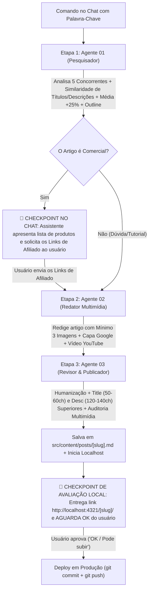

# 🤖 Orquestrador Geral da Esteira Editorial (Pipeline de Conteúdo)

Este documento é o guia de operação e comando rápido da esteira automatizada de produção de conteúdo do portal **Melhores Fones**. Ele integra e comanda os 3 agentes da pasta `agents-novos-artigos/`:

1. `01-pesquisador.md` (Pesquisa SERP no Google, análise de 5 concorrentes, similaridade de Títulos e Descrições da concorrência, média + 25% de palavras, similaridade de produtos e pauta Outline).
2. `02-redator.md` (Redação técnica audiófila com **mínimo de 3 imagens contextuais**, **capa de alto impacto para o Google**, **vídeo do YouTube incorporado** e layout idêntico ao site).
3. `03-revisor-publicador.md` (Humanização, criação de Title e Description superiores baseados na similaridade dos concorrentes com ajuste exato de 50-60 chars no Title e 120-140 na Description, auditoria das 3 imagens + vídeo, salvamento local em `src/content/posts/[slug].md` e **entrega obrigatória no `localhost` aguardando o "OK" do usuário antes de qualquer deploy**).

---

## ⚡ Como Acionar a Esteira com 1 Único Comando

Basta você colar no chat do Antigravity a seguinte frase substituindo pela sua palavra-chave desejada:

```text
Execute a esteira da pasta agents-novos-artigos para a palavra-chave: [SUA PALAVRA-CHAVE AQUI]
```

### Exemplos Práticos:
- **Artigo Comercial:**
  ```text
  Execute a esteira da pasta agents-novos-artigos para a palavra-chave: melhores fones bluetooth
  ```
- **Artigo de Dúvida / Tutorial:**
  ```text
  Execute a esteira da pasta agents-novos-artigos para a palavra-chave: como resetar fone bluetooth
  ```

---

## 🔄 Fluxo de Execução com Checkpoint de Afiliados, Multimídia & Aprovação em Localhost



---

### Regras Mandatórias de Cada Etapa:

#### 1. Pesquisa & Pauta (Agente 01)
- Abre o navegador integrado, descarta lojas e fóruns até encontrar **5 artigos de blog concorrentes válidos**.
- Mapeia a **similaridade de Títulos e Descrições** dos 5 primeiros colocados para identificar termos, ganchos e padrões que o Google está premiando.
- Mapeia a **similaridade de produtos** (se comercial) ou os pontos críticos da dúvida (se informacional).
- Calcula a **Meta de Palavras** (média dos concorrentes $+25\%$).

#### 2. Checkpoint de Links de Afiliados (Se Comercial)
- Se o artigo for comercial, pausa no chat, lista os modelos e aguarda você enviar os links de afiliados.

#### 3. Redação Multimídia no Padrão Visual do Site (Agente 02)
- **Capa Específica e Atraente:** Imagem de altíssima qualidade técnica para o Google (nunca logo genérica).
- **Mínimo de 3 Imagens com Contexto:** Capa $+ 2$ imagens no corpo do post ilustrando os passos práticos ou detalhes técnicos.
- **Vídeo do YouTube Incorporado:** Container responsivo 16:9 com tutorial ou review explicativo.
- **Se Comercial:** Botões CTA de afiliado com `.wp-block-button__link` e `rel="nofollow noopener"`.

#### 4. Humanização, SEO e Entrega em Localhost (Agente 03)
- Remove clichês de IA.
- **Engenharia Reversa de Metadados:** Cria um **Meta Title superior** (50 a 60 caracteres) e uma **Meta Description superior** (120 a 140 caracteres) superando a concorrência a partir dos padrões e similaridades identificados pelo Agente 01.
- Audita a presença da capa temática, das imagens contextuais e do vídeo funcional.
- Salva o arquivo `.md` diretamente em `src/content/posts/[slug].md` com Frontmatter completo.
- **Inicia o servidor local (`npm run dev -- --host --port 4321`)**, valida `HTTP 200 OK` e entrega obrigatoriamente o link clicável do `localhost` (`http://localhost:4321/[slug]/` e `http://127.0.0.1:4321/[slug]/`) para avaliação visual do usuário.

#### 5. 🛑 Regra Bloqueante de Deploy (Proibido Subir Sem "OK")
- **TERMINANTEMENTE PROIBIDO** executar `git commit`, `git push` ou qualquer deploy para produção antes de o usuário avaliar o artigo no `localhost` e dar aprovação explícita no chat (ex: *"OK"*, *"Pode subir"*, *"Pode fazer deploy"*).

---

## 🚨 REGRA Nº 0 DO ORQUESTRADOR (INEGOCIÁVEL): PESQUISA SEMPRE NO GOOGLE BRASIL

Esta regra é responsabilidade **exclusiva do Orquestrador**: ele conduz/aciona o Agente 01 e só libera a esteira se ela for cumprida. Os demais agentes seguem suas funções normalmente.

- A pesquisa de concorrentes é feita **SEMPRE e SÓ no Google Brasil** (`https://www.google.com.br`, com `gl=br&hl=pt-BR`), em navegador real (Chrome).
- 🚫 **JAMAIS** usar DuckDuckGo, Bing, Brave, Yahoo, `search_web` ou qualquer outro buscador/navegador para definir o Top 5.
- **Sem ferramenta de navegador:** abrir o Chrome pelo terminal (`chrome.exe --headless=new --dump-dom "https://www.google.com.br/search?q=[PALAVRA-CHAVE]&gl=br&hl=pt-BR&start=0"`, repetindo com `start=10` e `start=20`) e ler títulos e URLs dos resultados.
- **Captcha ou bloqueio:** **PARAR e avisar o usuário.** Nunca usar outra fonte nem contornar o bloqueio.
- **Conferência do Orquestrador:** antes de avançar para o Agente 02, confirmar que o relatório do Agente 01 traz os 5 concorrentes na ordem em que aparecem no Google Brasil. Se foram obtidos por outro meio, **descartar e refazer**.

---

## 🚨 REGRA Nº 0.1 DO ORQUESTRADOR (INEGOCIÁVEL): DISPONIBILIDADE REAL E ESTOQUE CONFIRMADO NA AMAZON BRASIL

Esta regra é aprendizado mandatório e dever inegociável do **Orquestrador**:
- **Estoque Ativo e Comprovado:** Todo produto sugerido em artigos comerciais **DEVE OBRIGATORIAMENTE ESTAR DISPONÍVEL PARA COMPRA IMEDIATA NA AMAZON BRASIL** (`amazon.com.br`).
- 🚫 **TERMINANTEMENTE PROIBIDO:** Incluir fones com status "Não disponível no momento", "Em falta", descontinuados, fora de linha ou com link/página de erro 404.
- **Substituição Obrigatória de Esgotados:** Se um modelo clássico ou citado por concorrentes do Top 5 estiver sem estoque na Amazon Brasil, o Orquestrador deve substituí-lo imediatamente por um modelo superior ou equivalente da mesma marca/categoria que **tenha estoque ativo confirmado na Amazon Brasil**.
- **Auditoria Prévia pelo Orquestrador:** O Orquestrador só libera a pauta e o payload para a redação após validar o ASIN, preço e a 1ª imagem oficial da Amazon em cada produto recomendado. Artigo comercial com fone indisponível é considerado falha grave do Orquestrador.

---

## 🚨 REGRA Nº 0.2 DO ORQUESTRADOR (INEGOCIÁVEL): PRETTY LINKS OBRIGATÓRIOS (SLUG DO PRODUTO + REDIRECT 301)

Esta regra é aprendizado mandatório e dever inegociável do **Orquestrador**:
- **Links Limpos com o Nome do Produto:** Todos os botões de conversão `.afpb__btn` e menções diretas nos artigos **DEVEM obrigatoriamente usar Pretty Links internos com o slug limpo do produto** no formato `/[slug-do-produto]/` (ex: `/sony-wh-1000xm4/`, `/shokz-openrun-pro-2/`, `/airpods-pro-2/`).
- 🚫 **TERMINANTEMENTE PROIBIDO:** Colocar URLs brutas da Amazon (`https://www.amazon.com.br/dp/...`) ou encurtadores externos antigos (`amzn.to`) diretamente no corpo do Markdown.
- **Cadastro Obrigatório no CSV:** Cada novo produto selecionado deve ter seu slug cadastrado em `src/data/pretty-links.csv`, mapeando o slug limpo para a URL oficial da Amazon comissionada com `tag=melhoresfon05-20` (redirecionamento 301).
- **Compilação Imediata de Redirects:** Sempre que um novo link for adicionado ao CSV, o Orquestrador deve compilar as regras executando:
  ```bash
  node scripts/generate-redirects.js
  ```
  garantindo que o arquivo `public/_redirects` contenha a regra ativa de redirecionamento 301 antes de liberar o artigo para preview local.

---

## 🚨 REGRA Nº 0.3 DO ORQUESTRADOR (INEGOCIÁVEL): ATUALIZAÇÃO OBRIGATÓRIA DA DATA DE PUBLICAÇÃO (PUBDATE)

Esta regra é aprendizado mandatório e dever inegociável do **Orquestrador**:
- **Renovação da Data de Publicação:** Sempre que houver uma atualização em qualquer artigo, a data de publicação (`pubDate:`) **DEVE ser obrigatoriamente atualizada para a data do dia da atualização** (`YYYY-MM-DD`), junto com `modDate:`.
- 🚫 **TERMINANTEMENTE PROIBIDO:** Deixar a data original antiga nos artigos atualizados. A `pubDate` renovada é vital para o frescor de SEO (Google Freshness) e para o leitor saber que as recomendações são atuais.

---

## 🚨 REGRA Nº 0.4 DO ORQUESTRADOR (INEGOCIÁVEL): ENGENHARIA REVERSA DE TÍTULOS E DESCRIÇÕES DOS 5 PRIMEIROS COLOCADOS

Esta regra é aprendizado mandatório e dever inegociável do **Orquestrador**:
- **Mapeamento Obrigatório de Títulos e Snippets:** Na pesquisa da SERP conduzida pelo Agente 01, o Orquestrador deve assegurar que sejam extraídos com precisão os **Títulos (Meta Titles)** e as **Descrições (Meta Descriptions / Snippets)** de cada um dos **5 artigos de blog concorrentes válidos**.
- **Análise de Similaridade e Padrões da SERP:** O Agente 01 deve mapear quais termos, promessas, ganchos (hooks), palavras de poder e intenções de clique se repetem entre os concorrentes que ocupam as primeiras posições do Google.
- **Criação de Título e Descrição Superiores pelo Agente 03:** O Agente 03 tem a obrigação de utilizar essa análise de similaridade para conceber um **Título mais atraente, claro e persuasivo** e uma **Meta Description superior**, que responda à intenção de busca com mais força que a concorrência.
- **Régua Estrita de Caracteres Já Definida (Sem Exceções):**
  - **Meta Title:** Exatamente entre **50 e 60 caracteres** (contando espaços e pontuação).
  - **Meta Description:** Exatamente entre **120 e 140 caracteres** (contando espaços e pontuação).
- 🚫 **TERMINANTEMENTE PROIBIDO:** Criar títulos ou descrições aleatórias sem antes analisar os 5 primeiros colocados, ou desrespeitar a contagem estrita de caracteres (menos de 50 ou mais de 60 no Title; menos de 120 ou mais de 140 na Description).
