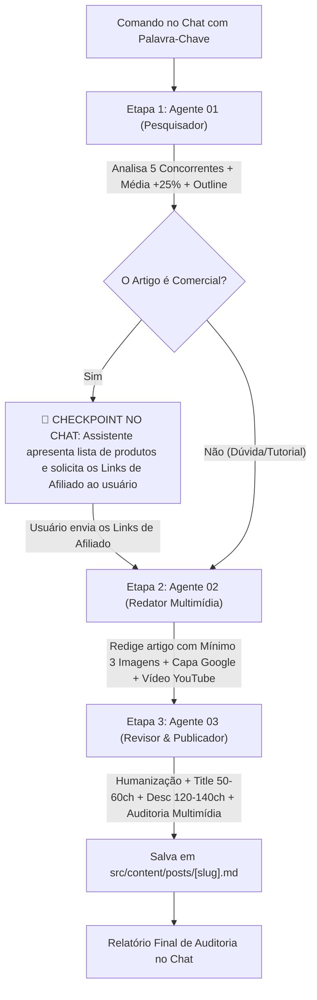

# 🤖 Orquestrador Geral da Esteira Editorial (Pipeline de Conteúdo)

Este documento é o guia de operação e comando rápido da esteira automatizada de produção de conteúdo do portal **Melhores Fones**. Ele integra e comanda os 3 agentes da pasta `agents-novos-artigos/`:

1. `01-pesquisador.md` (Pesquisa SERP no Google, análise de 5 concorrentes, média + 25% de palavras, similaridade de produtos e pauta Outline).
2. `02-redator.md` (Redação técnica audiófila com **mínimo de 3 imagens contextuais**, **capa de alto impacto para o Google**, **vídeo do YouTube incorporado** e layout idêntico ao site).
3. `03-revisor-publicador.md` (Humanização, ajuste exato de 50-60 chars no Title e 120-140 na Description, auditoria das 3 imagens + vídeo e salvamento em `src/content/posts/[slug].md`).

---

## ⚡ Como Acionar a Esteira com 1 Único Comando

Basta você colar no chat do Antigravity a seguinte frase substituindo pela sua palavra-chave desejada:

```text
Execute a esteira da pasta agents-novos-artigos para a palavra-chave: [SUA PALAVRA-CHAVE AQUI]
```

### Exemplos Práticos:
- **Artigo Comercial:**
  ```text
  Execute a esteira da pasta agents-novos-artigos para a palavra-chave: melhores fones bluetooth
  ```
- **Artigo de Dúvida / Tutorial:**
  ```text
  Execute a esteira da pasta agents-novos-artigos para a palavra-chave: como resetar fone bluetooth
  ```

---

## 🔄 Fluxo de Execução com Checkpoint de Afiliados & Multimídia



---

### Regras Mandatórias de Cada Etapa:

#### 1. Pesquisa & Pauta (Agente 01)
- Abre o navegador integrado, descarta lojas e fóruns até encontrar **5 artigos de blog concorrentes válidos**.
- Mapeia a **similaridade de produtos** (se comercial) ou os pontos críticos da dúvida (se informacional).
- Calcula a **Meta de Palavras** (média dos concorrentes $+25\%$).

#### 2. Checkpoint de Links de Afiliados (Se Comercial)
- Se o artigo for comercial, pausa no chat, lista os modelos e aguarda você enviar os links de afiliados.

#### 3. Redação Multimídia no Padrão Visual do Site (Agente 02)
- **Capa Específica e Atraente:** Imagem de altíssima qualidade técnica para o Google (nunca logo genérica).
- **Mínimo de 3 Imagens com Contexto:** Capa $+ 2$ imagens no corpo do post ilustrando os passos práticos ou detalhes técnicos.
- **Vídeo do YouTube Incorporado:** Container responsivo 16:9 com tutorial ou review explicativo.
- **Se Comercial:** Botões CTA de afiliado com `.wp-block-button__link` e `rel="nofollow noopener"`.

#### 4. Humanização, SEO e Publicação (Agente 03)
- Remove clichês de IA.
- Calibra a Meta Title (50 a 60 caracteres) e a Meta Description (120 a 140 caracteres).
- Audita a presença da capa temática, das imagens contextuais e do vídeo funcional.
- Salva o arquivo `.md` diretamente em `src/content/posts/[slug].md` com Frontmatter completo.
