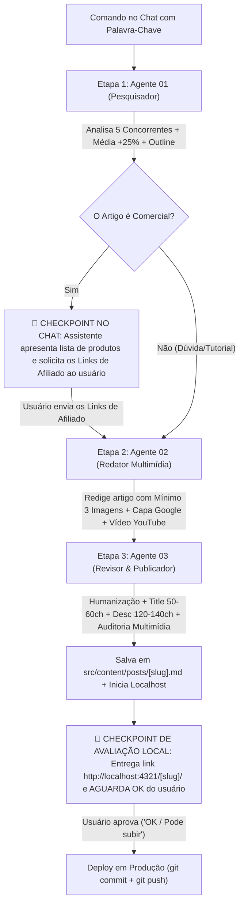

# 🤖 Orquestrador Geral da Esteira Editorial (Pipeline de Conteúdo)

Este documento é o guia de operação e comando rápido da esteira automatizada de produção de conteúdo do portal **Melhores Fones**. Ele integra e comanda os 3 agentes da pasta `agents-novos-artigos/`:

1. `01-pesquisador.md` (Pesquisa SERP no Google, análise de 5 concorrentes, média + 25% de palavras, similaridade de produtos e pauta Outline).
2. `02-redator.md` (Redação técnica audiófila com **mínimo de 3 imagens contextuais**, **capa de alto impacto para o Google**, **vídeo do YouTube incorporado** e layout idêntico ao site).
3. `03-revisor-publicador.md` (Humanização, ajuste exato de 50-60 chars no Title e 120-140 na Description, auditoria das 3 imagens + vídeo, salvamento local em `src/content/posts/[slug].md` e **entrega obrigatória no `localhost` aguardando o "OK" do usuário antes de qualquer deploy**).

---

## ⚡ Como Acionar a Esteira com 1 Único Comando

Basta você colar no chat do Antigravity a seguinte frase substituindo pela sua palavra-chave desejada:

```text
Execute a esteira da pasta agents-novos-artigos para a palavra-chave: [SUA PALAVRA-CHAVE AQUI]
```

### Exemplos Práticos:
- **Artigo Comercial:**
  ```text
  Execute a esteira da pasta agents-novos-artigos para a palavra-chave: melhores fones bluetooth
  ```
- **Artigo de Dúvida / Tutorial:**
  ```text
  Execute a esteira da pasta agents-novos-artigos para a palavra-chave: como resetar fone bluetooth
  ```

---

## 🔄 Fluxo de Execução com Checkpoint de Afiliados, Multimídia & Aprovação em Localhost



---

### Regras Mandatórias de Cada Etapa:

#### 1. Pesquisa & Pauta (Agente 01)
- Abre o navegador integrado, descarta lojas e fóruns até encontrar **5 artigos de blog concorrentes válidos**.
- Mapeia a **similaridade de produtos** (se comercial) ou os pontos críticos da dúvida (se informacional).
- Calcula a **Meta de Palavras** (média dos concorrentes $+25\%$).

#### 2. Checkpoint de Links de Afiliados (Se Comercial)
- Se o artigo for comercial, pausa no chat, lista os modelos e aguarda você enviar os links de afiliados.

#### 3. Redação Multimídia no Padrão Visual do Site (Agente 02)
- **Capa Específica e Atraente:** Imagem de altíssima qualidade técnica para o Google (nunca logo genérica).
- **Mínimo de 3 Imagens com Contexto:** Capa $+ 2$ imagens no corpo do post ilustrando os passos práticos ou detalhes técnicos.
- **Vídeo do YouTube Incorporado:** Container responsivo 16:9 com tutorial ou review explicativo.
- **Se Comercial:** Botões CTA de afiliado com `.wp-block-button__link` e `rel="nofollow noopener"`.

#### 4. Humanização, SEO e Entrega em Localhost (Agente 03)
- Remove clichês de IA.
- Calibra a Meta Title (50 a 60 caracteres) e a Meta Description (120 a 140 caracteres).
- Audita a presença da capa temática, das imagens contextuais e do vídeo funcional.
- Salva o arquivo `.md` diretamente em `src/content/posts/[slug].md` com Frontmatter completo.
- **Inicia o servidor local (`npm run dev -- --host --port 4321`)**, valida `HTTP 200 OK` e entrega obrigatoriamente o link clicável do `localhost` (`http://localhost:4321/[slug]/` e `http://127.0.0.1:4321/[slug]/`) para avaliação visual do usuário.

#### 5. 🛑 Regra Bloqueante de Deploy (Proibido Subir Sem "OK")
- **TERMINANTEMENTE PROIBIDO** executar `git commit`, `git push` ou qualquer deploy para produção antes de o usuário avaliar o artigo no `localhost` e dar aprovação explícita no chat (ex: *"OK"*, *"Pode subir"*, *"Pode fazer deploy"*).

---

## 🚨 REGRA Nº 0 DO ORQUESTRADOR (INEGOCIÁVEL): PESQUISA SEMPRE NO GOOGLE BRASIL

Esta regra é responsabilidade **exclusiva do Orquestrador**: ele conduz/aciona o Agente 01 e só libera a esteira se ela for cumprida. Os demais agentes seguem suas funções normalmente.

- A pesquisa de concorrentes é feita **SEMPRE e SÓ no Google Brasil** (`https://www.google.com.br`, com `gl=br&hl=pt-BR`), em navegador real (Chrome).
- 🚫 **JAMAIS** usar DuckDuckGo, Bing, Brave, Yahoo, `search_web` ou qualquer outro buscador/navegador para definir o Top 5.
- **Sem ferramenta de navegador:** abrir o Chrome pelo terminal (`chrome.exe --headless=new --dump-dom "https://www.google.com.br/search?q=[PALAVRA-CHAVE]&gl=br&hl=pt-BR&start=0"`, repetindo com `start=10` e `start=20`) e ler títulos e URLs dos resultados.
- **Captcha ou bloqueio:** **PARAR e avisar o usuário.** Nunca usar outra fonte nem contornar o bloqueio.
- **Conferência do Orquestrador:** antes de avançar para o Agente 02, confirmar que o relatório do Agente 01 traz os 5 concorrentes na ordem em que aparecem no Google Brasil. Se foram obtidos por outro meio, **descartar e refazer**.
