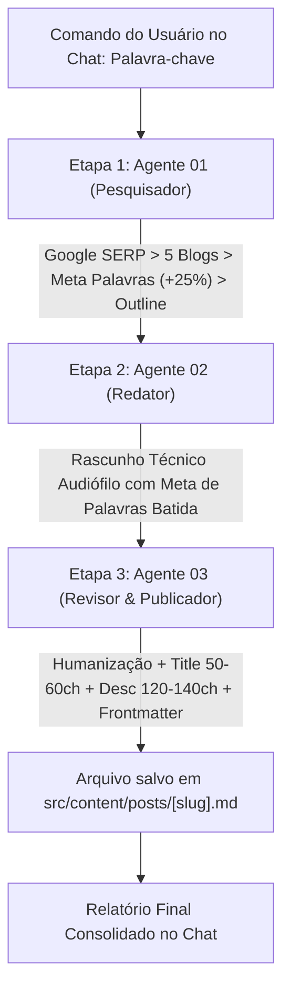

# 🤖 Orquestrador Geral da Esteira Editorial (Pipeline de Conteúdo)

Este documento é o guia de operação e comando rápido da esteira automatizada de produção de conteúdo do portal **Melhores Fones**. Ele integra e comanda os 3 agentes da pasta `agents/`:

1. `01-pesquisador.md` (Pesquisa SERP no Google, análise de 5 concorrentes, média + 25% de palavras, Outline H1-H4).
2. `02-redator.md` (Redação técnica, audiófila e profunda, atingindo a meta de palavras).
3. `03-revisor-publicador.md` (Humanização, corte de clichês, ajuste exato de 50-60 chars no Title e 120-140 na Description, validação de Frontmatter e salvamento em `src/content/posts/[slug].md`).

---

## ⚡ Como Acionar a Esteira com 1 Único Comando

Basta você colar no chat do Antigravity a seguinte frase substituindo pela sua palavra-chave desejada:

```text
Execute a esteira da pasta agents para a palavra-chave: [SUA PALAVRA-CHAVE AQUI]
```

### Exemplo Prático de Uso:
```text
Execute a esteira da pasta agents para a palavra-chave: melhor fone bluetooth para academia
```
ou
```text
Execute a esteira da pasta agents para a palavra-chave: como conectar fone bluetooth jbl no notebook
```

---

## 🔄 Fluxo de Execução Sequencial Automático (Sem Interrupções)

Quando você dispara o comando acima, o assistente executará automaticamente o ciclo completo em 3 etapas consecutivas:



### O que o assistente faz internamente em cada etapa:
1. **Passo 1 (Pesquisa e Pauta):**
   - Abre o navegador integrado, pesquisa a palavra no Google Brasil, descarta lojas/e-commerces/vídeos/fóruns até achar 5 blogs de reviews.
   - Extrai H1-H4, calcula a contagem de palavras úteis de cada um e define a Meta de Palavras (+25%).
   - Gera a Outline estruturada com diferenciais competitivos.

2. **Passo 2 (Redação Técnica e Aprofundada):**
   - Assume a persona audiófila e escreve o artigo completo em Markdown.
   - Aplica os conceitos sonoros (palco sonoro, resposta de frequência, drivers, ANC, codecs, etc.) e atinge a meta de palavras sem enrolação.

3. **Passo 3 (Humanização, SEO e Publicação Direta):**
   - Elimina clichês de IA.
   - Escreve a Title contendo rigorosamente entre 50 e 60 caracteres.
   - Escreve a Description contendo rigorosamente entre 120 e 140 caracteres.
   - Define a categoria (`melhores` ou `duvidas`).
   - Salva o arquivo no padrão oficial em `src/content/posts/[slug].md`.
   - Entrega no chat o resumo com os números da auditoria.

---

## 🎛️ Modos Alternativos de Execução (Opcional)

Se preferir validar a pauta antes de mandar escrever o texto, você também pode rodar as etapas separadamente:

- **Para rodar somente a pesquisa e aprovar a outline:**
  ```text
  Execute apenas a etapa 01-pesquisador para a palavra-chave: [PALAVRA-CHAVE]
  ```
- **Depois de aprovar a outline, para rodar a redação e publicação:**
  ```text
  Aprovei a pauta. Agora execute as etapas 02-redator e 03-revisor-publicador.
  ```
