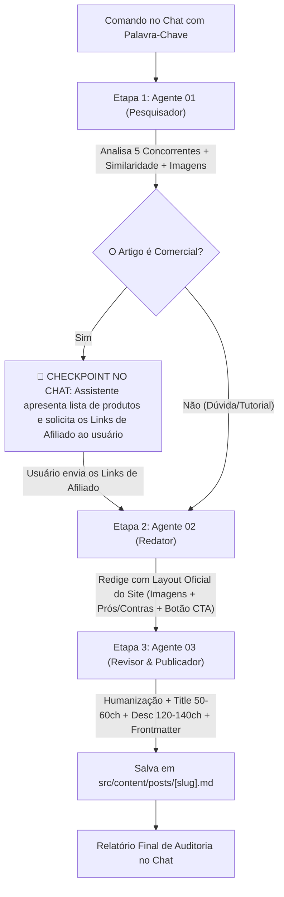

# 🤖 Orquestrador Geral da Esteira Editorial (Pipeline de Conteúdo)

Este documento é o guia de operação e comando rápido da esteira automatizada de produção de conteúdo do portal **Melhores Fones**. Ele integra e comanda os 3 agentes da pasta `agents/`:

1. `01-pesquisador.md` (Pesquisa SERP no Google, análise de 5 concorrentes, média + 25% de palavras, matriz de similaridade de produtos, coleta de imagens e pauta Outline).
2. `02-redator.md` (Redação técnica audiófila com layout idêntico ao site: imagens de produtos, prós/contras com emojis e botões CTA de afiliados).
3. `03-revisor-publicador.md` (Humanização, ajuste exato de 50-60 chars no Title e 120-140 na Description, auditoria de links/imagens e salvamento em `src/content/posts/[slug].md`).

---

## ⚡ Como Acionar a Esteira com 1 Único Comando

Basta você colar no chat do Antigravity a seguinte frase substituindo pela sua palavra-chave desejada:

```text
Execute a esteira da pasta agents para a palavra-chave: [SUA PALAVRA-CHAVE AQUI]
```

### Exemplos Práticos:
- **Artigo Comercial:**
  ```text
  Execute a esteira da pasta agents para a palavra-chave: melhores fones bluetooth
  ```
- **Artigo de Dúvida / Tutorial:**
  ```text
  Execute a esteira da pasta agents para a palavra-chave: como conectar fone bluetooth jbl no notebook
  ```

---

## 🔄 Fluxo de Execução com Checkpoint de Afiliados

O fluxo se adapta inteligentemente ao tipo de intenção de busca da palavra-chave:



---

### O que Acontece em Cada Etapa:

#### 1. Pesquisa & Pauta (Agente 01)
- Abre o navegador integrado, descarta lojas e fóruns até encontrar **5 artigos de blog concorrentes válidos**.
- Mapeia a **similaridade de produtos** (quais modelos mais se repetem entre os concorrentes) e seleciona a lista definitiva.
- Coleta as **URLs das imagens oficiais** de cada fone.
- Calcula a **Meta de Palavras** (média dos concorrentes $+25\%$).

#### 2. Checkpoint de Links de Afiliados (Interação Humana)
- Se o artigo for comercial, o assistente lista os fones e as imagens no chat e solicita:
  > *"Por favor, me envie os links de afiliado para os produtos acima."*
- Assim que você colar os links no chat, o assistente prossegue automaticamente para as etapas 02 e 03.

#### 3. Redação Técnica no Padrão Visual do Site (Agente 02)
- Segue rigorosamente o layout e a identidade visual de referência do **Melhores Fones**:
  - Imagem do produto em `<div class="wp-block-image"><figure></figure></div>`.
  - Análise profunda: palco sonoro, resposta de frequência, drivers, ANC, codecs e autonomia real.
  - Listas de `#### Prós:` (`✅`) e `#### Contras:` (`❌`).
  - Botão CTA estilizado com seu link de afiliado:
    ```html
    <div class="wp-block-buttons">
      <div class="wp-block-button">
        <a class="wp-block-button__link" href="SEU_LINK" target="_blank" rel="nofollow noopener">Ver preço</a>
      </div>
    </div>
    ```

#### 4. Humanização, SEO e Publicação (Agente 03)
- Remove clichês de IA.
- Calibra a Meta Title (50 a 60 caracteres) e a Meta Description (120 a 140 caracteres).
- Salva o arquivo `.md` diretamente em `src/content/posts/[slug].md` com Frontmatter completo.
- Entrega o relatório de publicação no chat.
